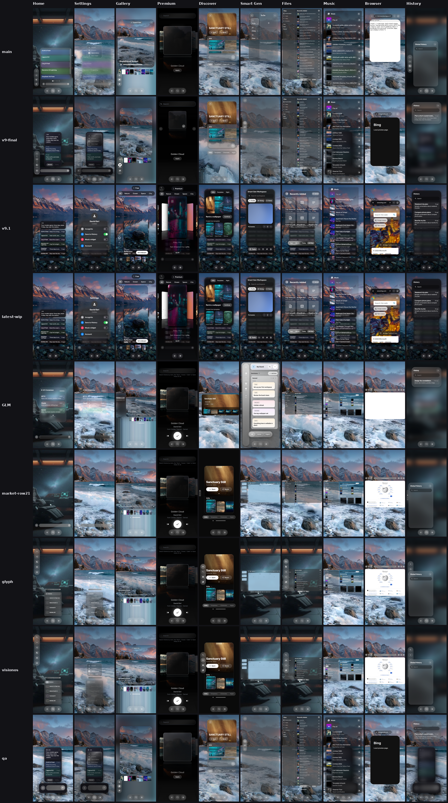

# Branch table

Smart Gen on this branch is the centred pane from `435e06f`, with the trello-clone board (lists, cards, drag, labels, guests, star, background) and the binding ledger surfaces. The word Workspace is not in that pane. The feature table and the phone photos are in [SMART-GEN-PARITY.md](SMART-GEN-PARITY.md).

One photo per branch and screen. The grid is [branch-review/branch-table.png](branch-review/branch-table.png). Each cell is an existing 390×844 capture (device pixel ratio 3), scaled into the grid. No new photos were taken of the current build or of `collider-latest-wip`.

Rows, top to bottom: `main`, `v9-final`, `v9.1`, `latest-wip`, `GLM`, `market-row21`, `glyph`, `visionos`, `qa`.

Columns, left to right: Home/ticker, Settings, Theme Gallery, Premium Market, Discover, Smart Gen, Files, Music, Browser, History.

`latest-wip` in the grid is the capture already on disk, from before this merge. `feat/ticker-isolation-and-budget` has no full screen set, so it has no row. Its compile fix stays on that branch (`6a98cf5`).

`visionos-portrait-rebuild` matches `glyph-cluster-visionos-spatial-aesthetic`. It is not a second source.

## David's verdict

| Screen | Taken from | What landed |
| --- | --- | --- |
| Home / ticker | `backup/glm-spatial-consistency` | The column window: press-toggle decay, category swipe, page dots, consensus row. Centred, at most 40% tall, a layer under the panes. Isolated models stay lit, under a hairline, with a left edge. The score still counts only the shared query. |
| History | `backup/glm-spatial-consistency`, tied with the previous leader | The centred notes window already on this branch. It is that GLM list, kept centred, with session edits. Not replaced with a top-aligned copy. |
| Theme Gallery | `backup/glm-spatial-consistency` | The gallery window, shelf switch, and conjured edge. The room behind it is not blurred. |
| Premium Market | `collider-latest-wip` | Not GLM. The CoverFlow market stays. |
| Discover | `collider-latest-wip`, window from `feat/market-row21-window` | Not GLM. The Grok feed stays inside the centred window. |
| Smart Gen | This branch, from the binding specs | The centred pane. The trello-clone board plus the section 9 views and ledger R1–R25. The glyph Keynote shell failed the pane guard and is not mounted. See [SMART-GEN-PARITY.md](SMART-GEN-PARITY.md). |
| Settings | `glyph-cluster-visionos-spatial-aesthetic` | The glass menu glyph shares with market-row21. No fade on the room. The menu edge fades. Glass on the menu. Google Sans Flex. |
| Browser | `collider-latest-wip` at `435e06f` | The glyph Safari shell was full-bleed and failed the pane guard. The tip's centred browser stays. |
| Music | `collider-latest-wip` at `435e06f` | The glyph stage was full-bleed and failed the pane guard. The tip's centred music pane stays. |
| Files | `collider-latest-wip` | None of the other branches have the approved v8.4 Files. This branch keeps that Files screen. |

Panes sit in the middle of the full screen, hosted by CPane. CShell keeps a bottom reserve for the docked ticker and the composer. The ticker column itself does not reserve a second band.

## Animations, from the code

No new motion recordings.

The base adds the materialise spring (`Materialize`, scale 0.9 to 1). The older branches do not have that spring. CoverFlow `Matrix4` poses are on the base and on `qa`.

`market-row21` and GLM mount a stardust overlay. It was not taken. Glyph and visionOS have the class and do not mount it.

GLM adds conjured glass (scale 0.94 to 1, fade, bloom) and a composer depth-of-field blur. The gallery shelf uses the conjured piece. The room blur that came with the GLM gallery was not taken.

Glyph, visionOS, and market-row21 add a 520ms entrance on the Discover market screen. That entrance was not taken. Smart Gen is the centred pane in [SMART-GEN-PARITY.md](SMART-GEN-PARITY.md).
