# Collider reference map

The customer's 27 references, grouped by the Collider surface each one was pointed at.

## How to read this

`Target` is **the customer's own wording** and is kept verbatim. It is an affinity assignment, not a description of the frame.

A lot of these frames are from other apps - row 16 is Apple iCloud, row 20 is Spotify, row 17 is an Airbnb listing, row 13 is a WeChat Moments feed. That is deliberate on their part: what they took from those frames was a *technique*, not a layout. So each entry records what the frame actually is (`Frame`) alongside what they pointed it at (`Target`), and what Collider is meant to do with it (`Use`).

Their comment and note text is unchanged throughout, including where the two contradict each other.

Companion document: [COMPONENT-CATALOG.md](COMPONENT-CATALOG.md) records where each primitive came from. This one records what each reference was for.

**27 of 27 references**, 29 placements across 13 surfaces.

| # | Target (customer's wording) | Frame (verified) | Collider surface |
|---|---|---|---|
| 1 | Premium Theme Market Design | CoverFlow photo carousel with a search bar and a play control | Premium Theme Market |
| 2 | Apps Overlay (icon grid) | Contact sheet of the whole visionOS reference library | Apps |
| 3 | Theme Gallery / Premium Market | Fitness app - hero headline, Start Working Out, collections carousel, left rail | Premium Theme Market, Apps |
| 4 | Theme Gallery / Premium Market | Theme/album CoverFlow with a transport bar | Premium Theme Market |
| 5 | General depth/blur technique | Contact sheet of the reference library (the blur/depth board) | Cross-surface: depth, blur, icons |
| 6 | Theme Gallery ↔ Premium Market transition | Media player - Extend View, photo, scrub bar, thumbnail filmstrip | Theme Gallery |
| 7 | Files work surface | Photos albums - sidebar, album grid with counts, Years/Months/Days segmented control, left rail | Files |
| 8 | Composer / Message Bar | iMessage message bar - avatar, text field, mic | Composer / Message Bar |
| 9 | Composer / Message Bar | Component spec sheet - Header / Buttons / Input Fields / Type / Avatars / Frames | Composer / Message Bar |
| 10 | In-App Browser | visionOS browser window with tab bar, in a room | Browser |
| 11 | General component set | Colour palette - a row of dots on transparent | Cross-surface: depth, blur, icons |
| 12 | Settings screen + App Selector | visionOS app grid beside a Home / People / Environments panel | Settings |
| 13 | Media Gen layout | WeChat Moments feed - profile card, post stream, pager | Media Gen |
| 14 | AI Chat conversation stream | Photo card with a Comments panel - per-person rows with avatars and action circles | Chat / Model Ticker |
| 15 | AI Chat conversation stream | WeChat chat window beside a profile panel, in a room | Chat / Model Ticker, Cross-surface: depth, blur, icons |
| 16 | Model Row Ticker (general) | Apple iCloud - sidebar message list beside a hero image and body text | Chat / Model Ticker |
| 17 | Theme Gallery — detail view | Airbnb listing detail - hero photo, meta rows, amenity grid, price and Reserve | Theme Gallery |
| 18 | Settings → Account tab | Apple TV account sheet - profile, Connected Apps, Manage Subscription, Clear Play History | Settings |
| 19 | Video playback | Video player with a transport bar, in a room | Music / playback |
| 20 | Discover Market | Spotify - sidebar, 'Good morning' rows, 'Made For You' carousel | Discover Market |
| 21 | Discover Market | TV service - hero carousel, Popular Drama filmstrip, category segmented control, left rail | Discover Market |
| 22 | Settings alert/popup | Alert card - icon, title, description, two actions | Settings |
| 23 | Smart Gen (Kanban) | Windows 11 widget board floating in a room, with a navbar and search bar | Smart Gen |
| 24 | Smart Gen reference | Presentation editor - slide list, canvas, top toolbar, zoom bar | Smart Gen |
| 25 | Smart Gen — inline editing | Strip of small frames - environments, a form, a card, an avatar with a badge | Smart Gen |
| 26 | Settings drawer | Settings overlay - a list panel and a glass dropdown with faded edges | Settings |
| 27 | Icon style (light emittance) | Export is blank (2.8 KB). The frame itself was not captured | Cross-surface: depth, blur, icons |

## Two rows that need a word

**Row 13 is not what the code calls it.** Node `26-1004` is a WeChat Moments feed - a profile card and a stream of posts. `figma_media_stage.dart` labelled its own frame "Row13" while actually transcribing a different scene (a 2610x1468 wechat layout with a likes grid and a comments column). The media surface that was rebuilt on 2026-10-09 came from that wechat scene, not from `26-1004`. The customer's own two lines point the same way in opposite directions - "quite a mediocrity. feel free to skip. low quality imo." against "this might be the superior layout choice for media gen:" - and both are left standing here rather than reconciled.

**Row 27 exported blank.** `docs/map-thumbs/27.jpg` is 2.8 KB and carries no image, so "Icon style (light emittance)" has nothing to work from. It needs re-exporting from Figma.

---

## Chat / Model Ticker

`lib/features/ticker/widgets/ticker_sheet.dart` · `lib/core/kit/focus_carousel.dart`

### 15. AI Chat conversation stream

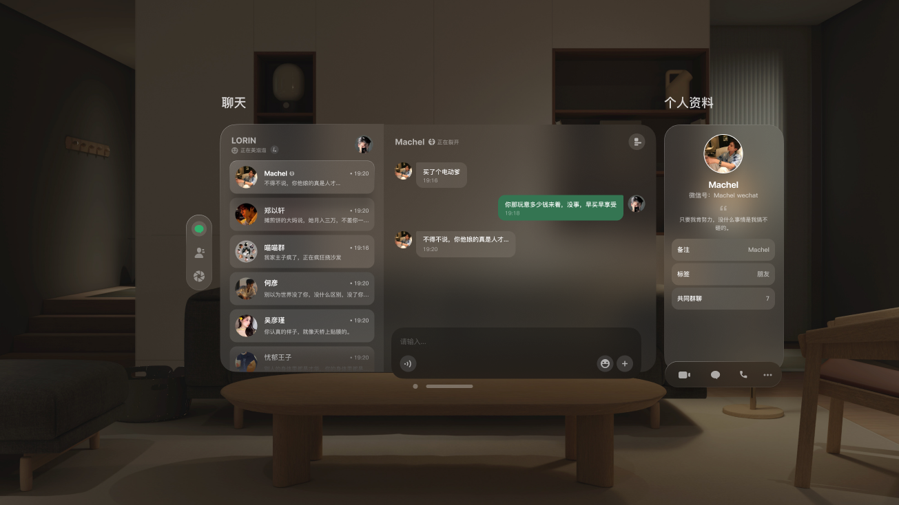

- **Frame** WeChat chat window beside a profile panel, in a room
- **Node** `0-639`
- **Use** Direct geometry. The ticker row metrics come from this wechat export: row 300x88, pitch 94, avatar 56, title 20/24 w700.
- **Status** Rebuilt 2026-10-09 from this export's geometry
- **Comment** "conversations on the right , and probably more trnasparent than that. while the background image stakes the full screen, allowing only this small overlap. and likely wont need to the ceiling stack. since we have scroll. probably halfway up is sufficient"
- **Note** "but do take notice of the details, lke the blur/fade on the edges. ive been calling out for this technique a lot. im glad to see it."

### 14. AI Chat conversation stream

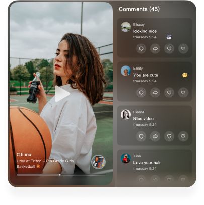

- **Frame** Photo card with a Comments panel - per-person rows with avatars and action circles
- **Node** `417-6826`
- **Use** Affinity. A comment row is a response row.
- **Status** Affinity applied

### 16. Model Row Ticker (general)

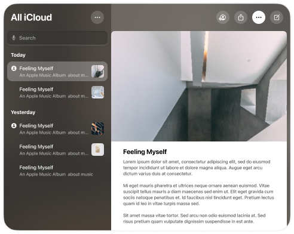

- **Frame** Apple iCloud - sidebar message list beside a hero image and body text
- **Node** `417-8104`
- **Use** Technique only - the customer wants elevation increasing as you go up the list, and colour used to distinguish. Not a ticker layout.
- **Status** Technique not yet applied
- **Comment** "proper use of coloring to distinguish"
- **Note** "also notice the increasing elevation of the message cards as you go up \| same idea. summary view. probably good for general model view:"

## Composer / Message Bar

`lib/features/prompt/`

### 8. Composer / Message Bar

- **Frame** iMessage message bar - avatar, text field, mic
- **Node** `1-240`
- **Use** Direct. The composer is a bar on the window it types into.
- **Status** Rebuilt 2026-10-09
- **Comment** "New kit:"
- **Note** "Model Responses \| https://www.figma.com/design/TReeWMHkw4GE5uKPhzvgMu/Apple-VisionOS-Apps---Basic- \| design-system--Community-?node-id=1-96&t=VjLBmOp6ttRVYJsU-4 \| message bar:"

### 9. Composer / Message Bar

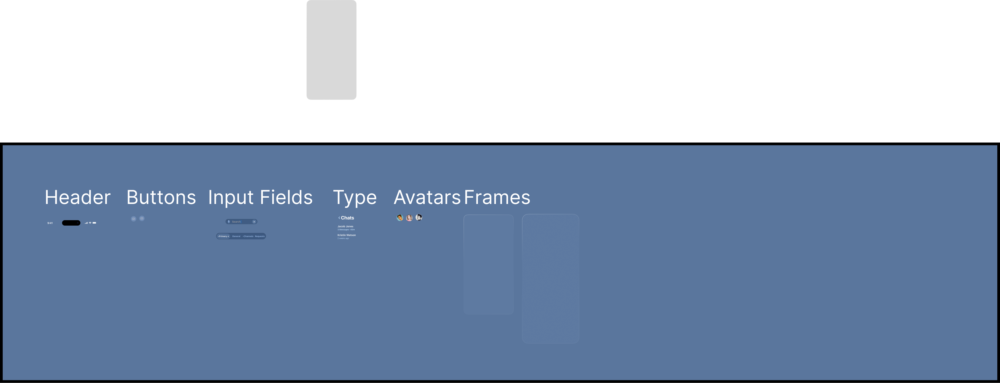

- **Frame** Component spec sheet - Header / Buttons / Input Fields / Type / Avatars / Frames
- **Node** `0-1`
- **Use** Spec sheet, not a frame.
- **Status** Not started

## Media Gen

`lib/features/mediagen/figma_media_stage.dart`

### 13. Media Gen layout

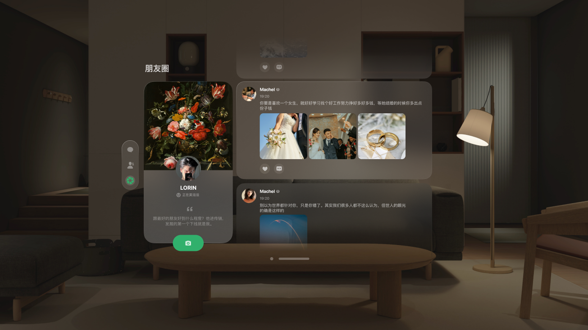

- **Frame** WeChat Moments feed - profile card, post stream, pager
- **Node** `26-1004`
- **Use** Customer says skip it. See the note below - it is not the frame the code called Row13.
- **Status** Rebuilt 2026-10-09, but from a different frame - see below
- **Comment** "quite a mediocrity. feel free to skip. low quality imo."
- **Note** "this might be the superior layout choice for media gen:"

## Smart Gen

`lib/features/smartgen/`

### 23. Smart Gen (Kanban)

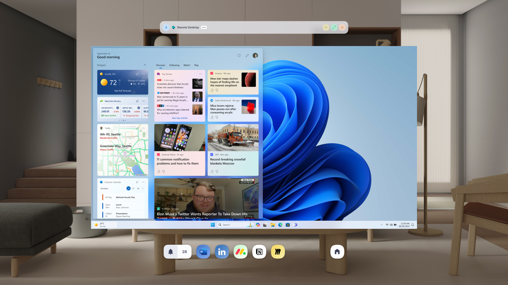

- **Frame** Windows 11 widget board floating in a room, with a navbar and search bar
- **Node** `2012-201531`
- **Use** Affinity. Board + navbar + search bar.
- **Comment** "smart gen:"
- **Note** "(pure kanban smart gen) i also love the navbar and search bar"

### 24. Smart Gen reference

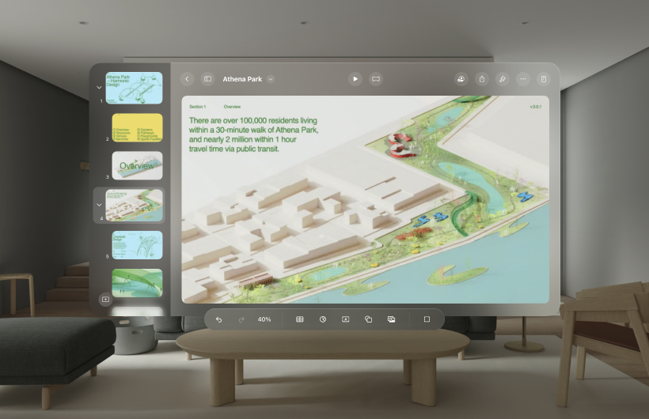

- **Frame** Presentation editor - slide list, canvas, top toolbar, zoom bar
- **Node** `30-75`
- **Use** Affinity. List beside canvas.

### 25. Smart Gen — inline editing

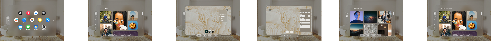

- **Frame** Strip of small frames - environments, a form, a card, an avatar with a badge
- **Node** `59-170`
- **Use** Affinity. Inline editing on a card.
- **Status** TSX port pending
- **Note** "(smart card editing in line on a board)"

## Discover Market

`lib/features/market/screens/market_screen.dart`

### 20. Discover Market

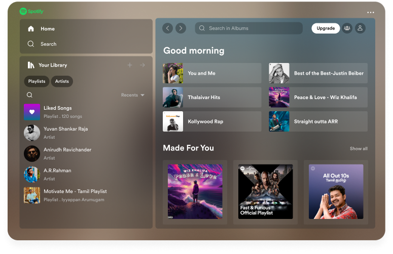

- **Frame** Spotify - sidebar, 'Good morning' rows, 'Made For You' carousel
- **Node** `417-6219`
- **Use** Affinity. Discovery arrangement.
- **Comment** "disocver market:"

### 21. Discover Market

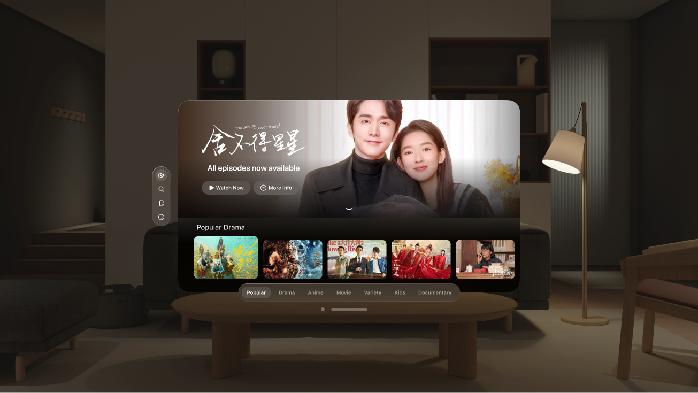

- **Frame** TV service - hero carousel, Popular Drama filmstrip, category segmented control, left rail
- **Node** `203-5891`
- **Use** Direct. Discover Market is a floating window, not a full-bleed grid.

## Theme Gallery

`lib/features/theme/`

### 6. Theme Gallery ↔ Premium Market transition

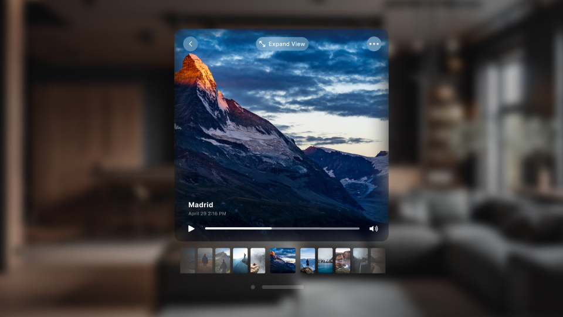

- **Frame** Media player - Extend View, photo, scrub bar, thumbnail filmstrip
- **Node** `69-1926`
- **Use** Affinity. Player chrome reused for theme preview.
- **Comment** "for the swipe down back to the regular theme selector:"

### 17. Theme Gallery — detail view

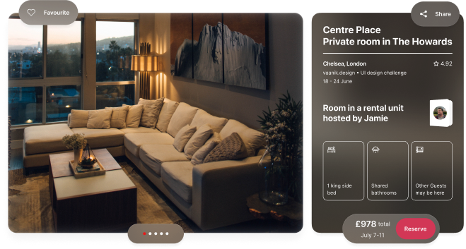

- **Frame** Airbnb listing detail - hero photo, meta rows, amenity grid, price and Reserve
- **Node** `417-15864`
- **Use** Affinity. Detail-view shape for a theme page.
- **Comment** "any of these you can use as a drop in. then minor edits."
- **Note** "premium wallpaper detial view with songs list."

## Premium Theme Market

`lib/features/theme/premium_theme_market_view.dart`

### 1. Premium Theme Market Design

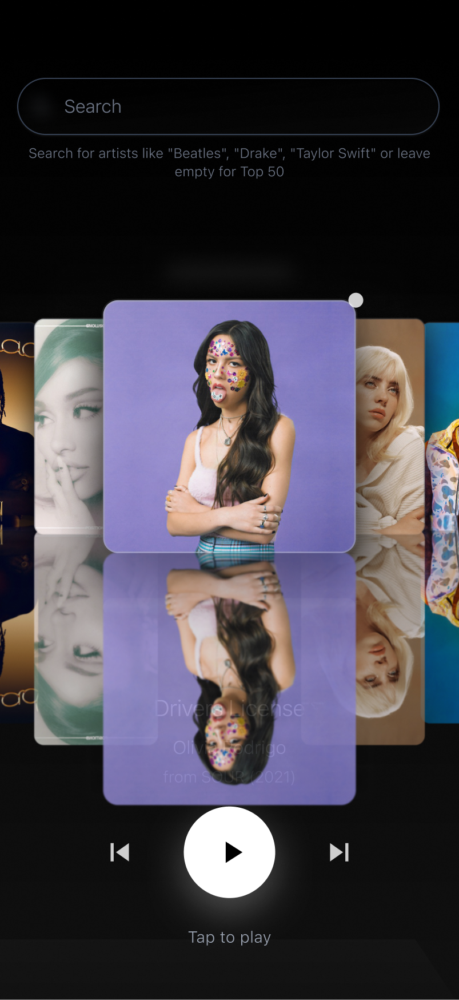

- **Frame** CoverFlow photo carousel with a search bar and a play control
- **Node** `1-3`
- **Use** Direct. The Premium Market carousel is built on this shape.
- **Status** Deliberately not re-applied
- **Comment** "Premium Theme Market Design"
- **Note** "Main design file — CoverFlow carousel with glass reflections, search bar, playback controls"

### 3. Theme Gallery / Premium Market

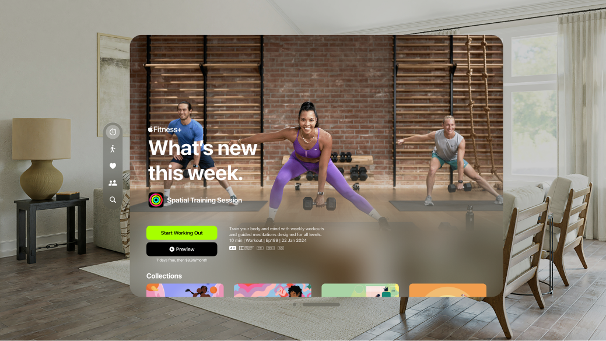

- **Frame** Fitness app - hero headline, Start Working Out, collections carousel, left rail
- **Node** `149-1202`
- **Use** Affinity. Carousel + left rail.
- **Status** 7-app platter change pending re-apply
- **Comment** "focus on example apps page."
- **Note** "app view frame for the Apps selection on thenav bar. the icons will need to be replaced with mine. which you can generate. \| for the theme selector idea attached, more precisely, the premium theme market:"

### 4. Theme Gallery / Premium Market

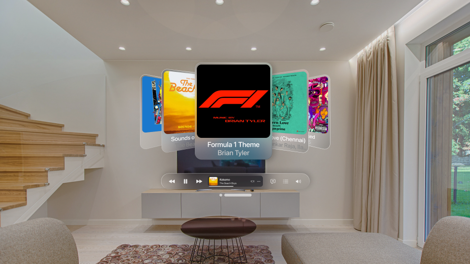

- **Frame** Theme/album CoverFlow with a transport bar
- **Node** `417-1777`
- **Use** Direct. Theme selector CoverFlow.

## Apps

`lib/features/apps/`

### 2. Apps Overlay (icon grid)

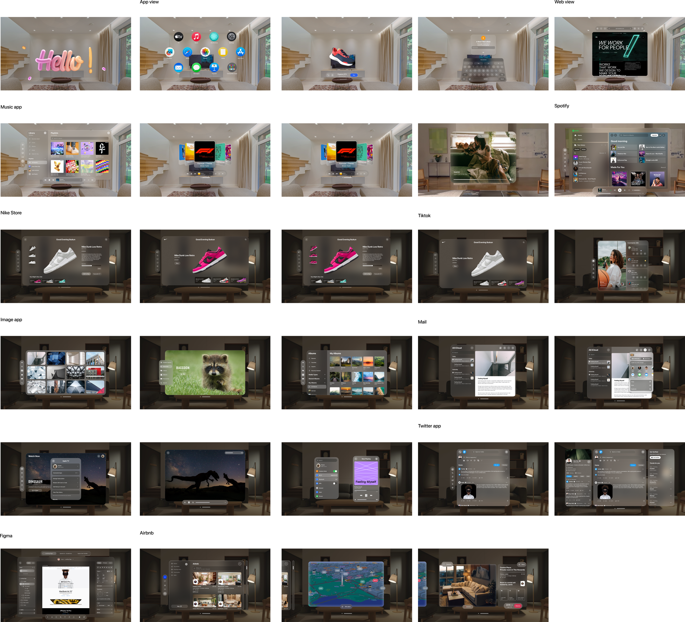

- **Frame** Contact sheet of the whole visionOS reference library
- **Node** `2-6774`
- **Use** Pointer to the library, not a layout.
- **Status** 7-app platter change pending re-apply
- **Comment** "Team Folder:"
- **Note** "https://www.figma.com/files/team/1640942759764734319/folder/606153351?fuid=1640942758085627402"

### 3. Theme Gallery / Premium Market  _(also mapped here)_

- **Frame** Fitness app - hero headline, Start Working Out, collections carousel, left rail
- **Node** `149-1202`
- **Use** Affinity. Carousel + left rail.
- **Status** 7-app platter change pending re-apply
- **Comment** "focus on example apps page."
- **Note** "app view frame for the Apps selection on thenav bar. the icons will need to be replaced with mine. which you can generate. \| for the theme selector idea attached, more precisely, the premium theme market:"

## Files

`lib/features/files/screens/files_screen.dart`

### 7. Files work surface

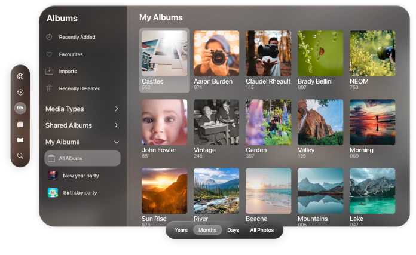

- **Frame** Photos albums - sidebar, album grid with counts, Years/Months/Days segmented control, left rail
- **Node** `71-7502`
- **Use** Affinity. Sidebar + grid is the Files shape.
- **Comment** "FIles:"

## Browser

`lib/features/browser/`

### 10. In-App Browser

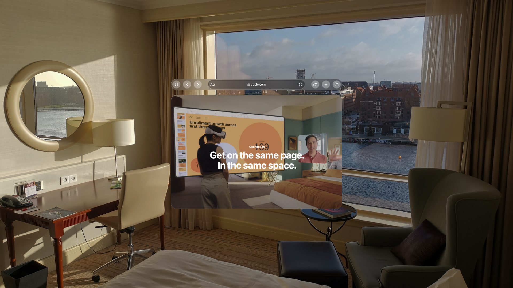

- **Frame** visionOS browser window with tab bar, in a room
- **Node** `1-71`
- **Use** Direct. Browser shell.
- **Comment** "you ca nbeautify a bit and add the features we need"
- **Note** "internet browser:"

## Music / playback

`lib/features/music/`

### 19. Video playback

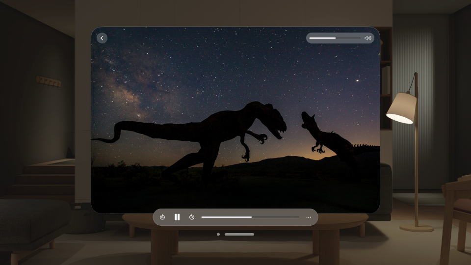

- **Frame** Video player with a transport bar, in a room
- **Node** `417-8630`
- **Use** Direct. Playback.
- **Comment** "we can make it smaller for sure."
- **Note** "video player:"

## Settings

`lib/features/account/`

### 12. Settings screen + App Selector

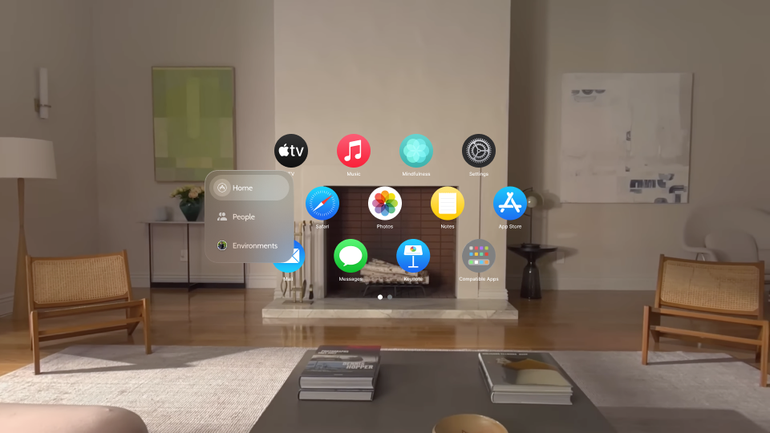

- **Frame** visionOS app grid beside a Home / People / Environments panel
- **Node** `97-34752`
- **Use** Direct. App selector beside Settings.
- **Comment** "ideal setting sscreen size plus App Selector:"

### 18. Settings → Account tab

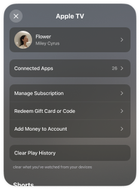

- **Frame** Apple TV account sheet - profile, Connected Apps, Manage Subscription, Clear Play History
- **Node** `417-8552`
- **Use** Direct. Account tab.
- **Comment** "account screen:"

### 22. Settings alert/popup

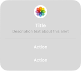

- **Frame** Alert card - icon, title, description, two actions
- **Node** `130-75006`
- **Use** Direct. Alert card.
- **Comment** "settings/alert popup:"

### 26. Settings drawer

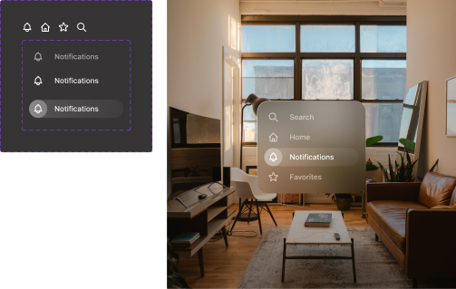

- **Frame** Settings overlay - a list panel and a glass dropdown with faded edges
- **Node** `0-1`
- **Use** Direct, including the faded edges they asked for.
- **Comment** "settings overlay again. faded edges would look great:"

## Cross-surface: depth, blur, icons

`lib/core/kit/collider_kit.dart`

### 5. General depth/blur technique

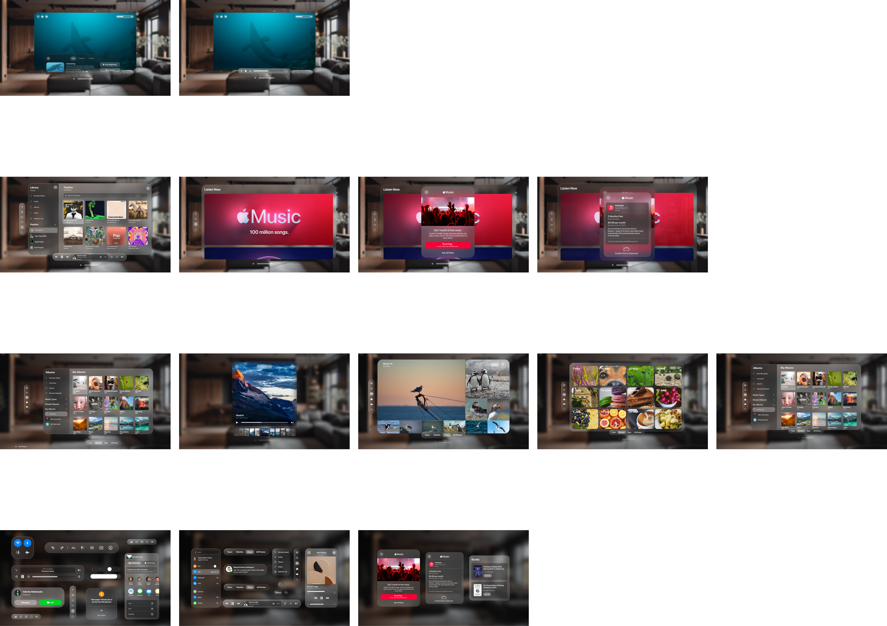

- **Frame** Contact sheet of the reference library (the blur/depth board)
- **Node** `0-1`
- **Use** Technique only - depth from stacked blur.
- **Comment** "we can even get more cinematic with ours."
- **Note** "Next Kit: this one does good job of showing depth with blurs"

### 11. General component set

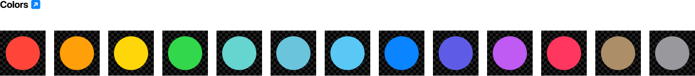

- **Frame** Colour palette - a row of dots on transparent
- **Node** `0-1746`
- **Use** Token source.
- **Comment** "complete ui component set:"

### 27. Icon style (light emittance)

- **Frame** Export is blank (2.8 KB). The frame itself was not captured
- **Node** `1-69`
- **Use** Nothing usable - the export is blank.
- **Status** Blocked - no usable export
- **Comment** "very nice icons: light emittnce"

### 15. AI Chat conversation stream  _(also mapped here)_

- **Frame** WeChat chat window beside a profile panel, in a room
- **Node** `0-639`
- **Use** Direct geometry. The ticker row metrics come from this wechat export: row 300x88, pitch 94, avatar 56, title 20/24 w700.
- **Status** Rebuilt 2026-10-09 from this export's geometry
- **Comment** "conversations on the right , and probably more trnasparent than that. while the background image stakes the full screen, allowing only this small overlap. and likely wont need to the ceiling stack. since we have scroll. probably halfway up is sufficient"
- **Note** "but do take notice of the details, lke the blur/fade on the edges. ive been calling out for this technique a lot. im glad to see it."
